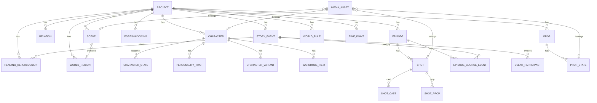

# AI漫剧工作台 数据模型设计

## 修订记录

| 版本 | 日期 | 修订人 | 变更摘要 |
|---|---|---|---|
| V1.0 | 2026-09-26 | CodeBuddy | 首版 |
| V1.1 | 2026-09-26 | CodeBuddy | 落实豆包四项拍板（丹药 / 配方建表、生成留痕全量保留、模型原文入库、出图并发）；按 Phase 2 建表实测修正角色状态快照的唯一约束（见 §4.8）；补充 §10 落地状态 |
| V1.2 | 2026-09-27 | CodeBuddy | Phase 2 第 4 步 CRUD API 落地：`story_events` / `pending_repercussions` / `character_states` / `foreshadowings` 增加 `batch_id` 与 `confirmed`，承载「确认才落盘」（见 §4.5、§4.8、§4.9）；§10 补充接口清单与实测 |
| V1.3 | 2026-09-27 | CodeBuddy | Phase 3 第一批前端三页接后端，补 `character_states` 的读写端点（人设页要能登记境界 / 声望 / 宗门 / 阵营）；§10.0 端点表补齐 |
| V1.4 | 2026-09-27 | CodeBuddy | Phase 4 编排链路：`episodes` 加 `confirmed` / `batch_id`，`index_no` 改为可空（「草案不带集次，确认才发号」）；新增编排端点与节拍 / 事件绑定端点，见 §4.6 与 §10.0 |
| V1.5 | 2026-09-27 | CodeBuddy | Phase 5 剧本链路：上下文切片（四层预算）、规则版编剧、六项审查、定稿回写。剧本正文挂 `episodes.script`，无独立表；审查落 `review_reports` / `review_issues`。见 §10.0 |

## 1. 设计原则

1. **业务实体独立建表**：角色、事件、分集、伏笔、关系、待办后果、角色状态一律独立表 + 外键，保证可以按天数、集次、角色检索。JSON 列只用于"视觉/排版类配置"这类不需要被查询的值对象。
2. **两个时间锚点并存**：故事内时间以**绝对天数**（`day`）为真正锚点，集次（`ep_index`）在编排后回填。任何跨阶段查询都靠这两列换算，不允许只存其一。
3. **引用用 id，不用名字**：原型阶段大量用角色名/道具名做字符串匹配（"剧本里出现了这个名字"），应用层一律改为外键引用；别名表（`*_aliases`）承接"同物异名"的命中需求。
4. **可追溯**：状态变化记录来源事件（`origin_event_id`、`last_change_event_id`），生成类操作留痕（提示词、返回、审查报告）。
5. **可重跑**：推演、审查、回写都是纯逻辑，落盘以事务为单位，失败不留半成品。

## 2. 存储方案

| 库 | 位置 | 作用 |
|---|---|---|
| 系统库 | `backend/data/workbench.db` | 只存项目索引：项目标识、名称、题材、状态、数据文件路径、更新时间 |
| 项目库 | `projects/<项目标识>/project.db` | 单个项目的全部业务数据（角色、事件、分集、素材…） |
| 项目资产 | `projects/<项目标识>/assets/` | 图片、视频、音频等文件；库内只存相对路径 |

理由：项目可整体拷贝与备份（SRS 4.2）；一个项目的数据量增长不会拖慢其他项目的打开速度；系统库保持轻量，项目列表加载快。

> **Phase 1 既有表的处置**：`backend/app/models/project.py` 目前是"项目索引 + `data` JSON 列一把梭"。本模型生效后该列作废，仅保留索引字段；已有数据通过一次性迁移脚本拆到项目库（见 §7）。

## 3. 实体关系（ER）



**核心关系说明**

- 一个事件可被多集引用（`episode_source_events`），一段事件换视角可编多集。
- 事件与角色是多对多（`event_participants`），不再用名字数组。
- 角色状态是**按集 + 按天**的快照表，`character_states` 唯一约束 `(character_id, ep_index)`，推演阶段的快照 `ep_index = 0`。
- 已知信息集是独立子表 `character_state_known_facts`，供信息集检查按人检索。
- 待办后果自引用事件（`trigger_event_id`、`resolved_event_id`），形成"种因 → 结果"的闭环。
- 所有图片/视频/音频统一进 `media_assets`，按 `owner_type + owner_id` 归属，带版本号与是否基准图。

## 4. 表结构

> 约定：主键统一为 36 字符文本（`uuid4().hex`）；时间列用 `DATETIME`；枚举用 `TEXT` + `CHECK`；布尔用 `INTEGER` (0/1)。以下 DDL 可直接执行。

### 4.1 系统库

```sql
-- 项目索引（系统库）
CREATE TABLE projects (
  id            TEXT PRIMARY KEY,
  name          TEXT NOT NULL UNIQUE,
  tag           TEXT NOT NULL DEFAULT '',       -- 题材，如"古风 · 奇幻"
  status        TEXT NOT NULL DEFAULT '草稿'
                CHECK (status IN ('草稿','进行中','已完成')),
  desc          TEXT NOT NULL DEFAULT '',
  dir_name      TEXT NOT NULL,                  -- projects/ 下的目录名，与 id 同值
  created_at    DATETIME NOT NULL DEFAULT CURRENT_TIMESTAMP,
  updated_at    DATETIME NOT NULL DEFAULT CURRENT_TIMESTAMP
);
CREATE INDEX idx_projects_updated ON projects(updated_at DESC);
```

### 4.2 项目与世界观（项目库）

```sql
-- 项目本体：一个项目库内只有一行
CREATE TABLE project (
  id              TEXT PRIMARY KEY,
  name            TEXT NOT NULL,
  desc            TEXT NOT NULL DEFAULT '',
  genre           TEXT NOT NULL DEFAULT '',
  ratio           TEXT,                          -- 画幅；NULL = 未定义
  art             TEXT,                          -- 美术风格；NULL = 未定义
  outline         TEXT NOT NULL DEFAULT '',      -- 故事大纲
  -- 故事时间游标
  era             TEXT NOT NULL DEFAULT '山海历',
  year            INTEGER NOT NULL DEFAULT 1,
  month           INTEGER NOT NULL DEFAULT 1,
  day             INTEGER NOT NULL DEFAULT 1,
  -- 系列主线弧光（短剧为 NULL）
  central_question TEXT,
  protagonist_goal TEXT,
  final_antagonist TEXT,
  end_direction   TEXT,
  -- 主角主线任务
  quest_goal      TEXT NOT NULL DEFAULT '',
  quest_done_when TEXT NOT NULL DEFAULT '',
  quest_stage     TEXT NOT NULL DEFAULT '',
  quest_obstacle  TEXT,
  created_at      DATETIME NOT NULL DEFAULT CURRENT_TIMESTAMP,
  updated_at      DATETIME NOT NULL DEFAULT CURRENT_TIMESTAMP
);

-- 力量天花板（按季解锁）
CREATE TABLE series_power_ceilings (
  id           TEXT PRIMARY KEY,
  season_index INTEGER NOT NULL,
  unlock       TEXT NOT NULL
);
CREATE INDEX idx_power_ceiling_season ON series_power_ceilings(season_index);

-- 世界观规则条目（铁律）
CREATE TABLE world_rules (
  id    TEXT PRIMARY KEY,
  title TEXT NOT NULL,
  desc  TEXT NOT NULL DEFAULT ''
);

-- 世界分区
CREATE TABLE world_regions (
  id    TEXT PRIMARY KEY,
  name  TEXT NOT NULL,
  desc  TEXT NOT NULL DEFAULT '',
  rule  TEXT NOT NULL DEFAULT '',   -- 注入该区所有场景的默认约束
  tags  TEXT NOT NULL DEFAULT '',   -- 逗号分隔：气候 / 势力 / 危险度
  x     REAL NOT NULL DEFAULT 50,   -- 地图相对坐标 0-100
  y     REAL NOT NULL DEFAULT 50
);

-- 世界观自定义参数
CREATE TABLE world_realms (       -- 境界 / 等级体系，按顺序
  id    TEXT PRIMARY KEY,
  seq   INTEGER NOT NULL,
  name  TEXT NOT NULL
);
CREATE TABLE world_item_grades (  -- 物品等级
  id    TEXT PRIMARY KEY,
  seq   INTEGER NOT NULL,
  name  TEXT NOT NULL
);
CREATE TABLE world_extra_rules (  -- 自由规则
  id     TEXT PRIMARY KEY,
  seq    INTEGER NOT NULL,
  content TEXT NOT NULL
);
CREATE TABLE world_special_items ( -- 特殊道具：可触发特定事件
  id             TEXT PRIMARY KEY,
  name           TEXT NOT NULL,
  purpose        TEXT NOT NULL DEFAULT '',
  trigger_event_id TEXT            -- 持有它时可触发的事件模板标识
);

-- 丹药与丹方（2026-09-26 拍板：建表，先建空表，修仙题材正式启用时再填数据）
CREATE TABLE world_pills (
  id       TEXT PRIMARY KEY,
  name     TEXT NOT NULL,
  grade_id TEXT,                 -- 指向 world_item_grades.id
  effect   TEXT NOT NULL DEFAULT '',
  desc     TEXT NOT NULL DEFAULT ''
);
CREATE TABLE world_recipes (
  id          TEXT PRIMARY KEY,
  name        TEXT NOT NULL,
  pill_id     TEXT,              -- 指向 world_pills.id；一方可产多味时各记一条
  materials   TEXT NOT NULL DEFAULT '',
  yield_count INTEGER NOT NULL DEFAULT 1,
  desc        TEXT NOT NULL DEFAULT ''
);
```

### 4.3 角色

```sql
CREATE TABLE characters (
  id             TEXT PRIMARY KEY,
  name           TEXT NOT NULL,
  role           TEXT NOT NULL DEFAULT '',     -- 身份描述
  desc           TEXT NOT NULL DEFAULT '',
  slot           TEXT NOT NULL DEFAULT '配角'
                 CHECK (slot IN ('主角','男主','女主','配角','反派','线索人物')),
  age_base       INTEGER NOT NULL DEFAULT 0,
  age_anchor_year INTEGER NOT NULL DEFAULT 1,
  auto_age       INTEGER NOT NULL DEFAULT 1,
  is_pov         INTEGER NOT NULL DEFAULT 0,   -- 视角人物
  ref_photo      TEXT,                          -- 参考照片相对路径
  current_goal   TEXT NOT NULL DEFAULT '',      -- 短期目标，推演更新
  drive          TEXT NOT NULL DEFAULT '',      -- 长期驱动力
  created_at     DATETIME NOT NULL DEFAULT CURRENT_TIMESTAMP,
  updated_at     DATETIME NOT NULL DEFAULT CURRENT_TIMESTAMP
);
CREATE UNIQUE INDEX idx_characters_name ON characters(name);
CREATE INDEX idx_characters_pov ON characters(is_pov);

-- 角色标签（自由标签）
CREATE TABLE character_tags (
  id           TEXT PRIMARY KEY,
  character_id TEXT NOT NULL REFERENCES characters(id) ON DELETE CASCADE,
  tag          TEXT NOT NULL
);

-- 性格标签（带强度，决定推演触发概率）
CREATE TABLE personality_traits (
  id           TEXT PRIMARY KEY,
  character_id TEXT NOT NULL REFERENCES characters(id) ON DELETE CASCADE,
  tag          TEXT NOT NULL,
  intensity    TEXT NOT NULL DEFAULT 'mid' CHECK (intensity IN ('low','mid','high'))
);
CREATE INDEX idx_traits_char ON personality_traits(character_id);

-- 身份原型（内置 + 项目自定义）
CREATE TABLE archetypes (
  id           TEXT PRIMARY KEY,
  name         TEXT NOT NULL,
  group_name   TEXT NOT NULL CHECK (group_name IN ('职业','种族','阵营','身份')),
  desc         TEXT NOT NULL DEFAULT '',
  image_prompt TEXT NOT NULL DEFAULT '',
  speech       TEXT NOT NULL DEFAULT '',
  builtin      INTEGER NOT NULL DEFAULT 0
);
CREATE TABLE archetype_behaviors (   -- 行为约束
  id           TEXT PRIMARY KEY,
  archetype_id TEXT NOT NULL REFERENCES archetypes(id) ON DELETE CASCADE,
  seq          INTEGER NOT NULL,
  content      TEXT NOT NULL
);
CREATE TABLE archetype_taboos (      -- 一致性校验禁忌
  id           TEXT PRIMARY KEY,
  archetype_id TEXT NOT NULL REFERENCES archetypes(id) ON DELETE CASCADE,
  content      TEXT NOT NULL
);
CREATE TABLE character_archetypes (  -- 角色 ↔ 原型（多对多）
  id           TEXT PRIMARY KEY,
  character_id TEXT NOT NULL REFERENCES characters(id) ON DELETE CASCADE,
  archetype_id TEXT NOT NULL REFERENCES archetypes(id) ON DELETE CASCADE
);

-- 形象变体
CREATE TABLE character_variants (
  id           TEXT PRIMARY KEY,
  character_id TEXT NOT NULL REFERENCES characters(id) ON DELETE CASCADE,
  name         TEXT NOT NULL,
  kind         TEXT NOT NULL CHECK (kind IN ('age','state','costume')),
  trigger      TEXT NOT NULL DEFAULT '',
  age_from     INTEGER,
  age_to       INTEGER,
  prompt_delta TEXT NOT NULL DEFAULT '',
  status       TEXT NOT NULL DEFAULT 'todo' CHECK (status IN ('todo','running','done'))
);

-- 衣橱
CREATE TABLE wardrobe_items (
  id           TEXT PRIMARY KEY,
  character_id TEXT NOT NULL REFERENCES characters(id) ON DELETE CASCADE,
  name         TEXT NOT NULL,
  part         TEXT NOT NULL DEFAULT '',   -- 整体 / 上装 / 下装 / 外披 / 鞋履 / 配饰 / 道具
  colors       TEXT NOT NULL DEFAULT '',
  material     TEXT NOT NULL DEFAULT '',
  is_default   INTEGER NOT NULL DEFAULT 0,
  status       TEXT NOT NULL DEFAULT 'todo' CHECK (status IN ('todo','running','done'))
);
CREATE TABLE wardrobe_scenes (        -- 适用分区 / 场景
  id         TEXT PRIMARY KEY,
  item_id    TEXT NOT NULL REFERENCES wardrobe_items(id) ON DELETE CASCADE,
  scene_id   TEXT NOT NULL            -- 引用 scenes.id；空串表示全剧通用，用 scene_ids 表达
);

-- 配音配置（值对象，一人一行）
CREATE TABLE character_voices (
  id           TEXT PRIMARY KEY,
  character_id TEXT NOT NULL UNIQUE REFERENCES characters(id) ON DELETE CASCADE,
  preset       TEXT NOT NULL DEFAULT '',
  gender       TEXT NOT NULL DEFAULT '女',
  pitch        INTEGER NOT NULL DEFAULT 0,      -- -10 ~ +10
  speed        REAL NOT NULL DEFAULT 1.0,       -- 0.5 ~ 2.0
  ref_audio    TEXT,                            -- 参考音频相对路径
  locked       INTEGER NOT NULL DEFAULT 0,
  status       TEXT NOT NULL DEFAULT 'todo' CHECK (status IN ('todo','running','done'))
);
CREATE TABLE voice_emotions (
  id        TEXT PRIMARY KEY,
  voice_id  TEXT NOT NULL REFERENCES character_voices(id) ON DELETE CASCADE,
  emotion   TEXT NOT NULL,
  sample    TEXT NOT NULL DEFAULT ''     -- 试听样例相对路径
);
```

### 4.4 关系网

```sql
CREATE TABLE relations (
  id                   TEXT PRIMARY KEY,
  from_character_id    TEXT NOT NULL REFERENCES characters(id) ON DELETE CASCADE,
  to_character_id      TEXT NOT NULL REFERENCES characters(id) ON DELETE CASCADE,
  type                 TEXT NOT NULL,     -- 父子 / 师徒 / 仇人 / …（枚举见 SRS §5）
  affinity             INTEGER NOT NULL DEFAULT 0,   -- -100 ~ +100，双向各记一条
  address              TEXT NOT NULL DEFAULT '',     -- 发起方如何称呼对方
  note                 TEXT NOT NULL DEFAULT '',
  origin_event_id      TEXT REFERENCES story_events(id) ON DELETE SET NULL,
  last_change_event_id TEXT REFERENCES story_events(id) ON DELETE SET NULL,
  CHECK (from_character_id <> to_character_id)
);
CREATE UNIQUE INDEX idx_relation_pair ON relations(from_character_id, to_character_id);
CREATE INDEX idx_relation_affinity ON relations(affinity);
```

> 好感轴是同一条数的正负两端：正端为心，负端为火。分档换算（每 20 为一档）：+1~20 认识，+21 起按心计（1 心…5 心）；负值未满一档为厌恶；负端满 20 为 1 火，起杀意。换算逻辑在实现层统一函数，不落冗余列。
>
> **建表顺序提示**：`relations` 外键引用 `story_events`，`shot_props` 引用 `prop_states`。实际执行 DDL 时先建被引用表（`story_events` 先于 `relations`，`prop_states` 先于 `shots`）；SQLite 在 DDL 阶段不校验被引用表是否存在，但保持顺序可避免迁移脚本踩坑。

### 4.5 事件流与因果链

```sql
CREATE TABLE story_events (
  id           TEXT PRIMARY KEY,
  seq          INTEGER NOT NULL,             -- 全局递增序号，只保证顺序
  day          INTEGER NOT NULL,             -- 绝对天数：真正的时间锚点
  time_unit    TEXT NOT NULL DEFAULT 'day' CHECK (time_unit IN ('year','month','day')),
  time_ref     TEXT NOT NULL DEFAULT '',     -- 时间轴标签（对应 time_points.label）
  scale        TEXT NOT NULL DEFAULT 'coarse' CHECK (scale IN ('coarse','fine')),
  parent_id    TEXT REFERENCES story_events(id) ON DELETE SET NULL,  -- 细化子事件指向母事件
  on_mainline  INTEGER NOT NULL DEFAULT 0,   -- 踩主线
  driver       TEXT,                          -- 驱动这条事件的性格标签
  chance       REAL,                          -- 发生概率
  location     TEXT NOT NULL DEFAULT '',
  action       TEXT NOT NULL DEFAULT '',      -- 一句话事实
  source       TEXT NOT NULL DEFAULT 'simulate'
               CHECK (source IN ('simulate','script','manual')),  -- 来源：推演 / 剧本回写 / 手工
  ep_index     INTEGER NOT NULL DEFAULT 0,   -- 剧本回写的事件所属集次；推演阶段为 0
  batch_id     TEXT,                          -- 产出这批的推演批次（generation_runs.id）
  confirmed    INTEGER NOT NULL DEFAULT 0,    -- 确认才落盘：推演与手工新增先进临时态
  confirmed_at DATETIME,
  created_at   DATETIME NOT NULL DEFAULT CURRENT_TIMESTAMP
);
CREATE INDEX idx_events_day ON story_events(day);
CREATE INDEX idx_events_seq ON story_events(seq);
CREATE INDEX idx_events_ep ON story_events(ep_index);
CREATE INDEX idx_events_parent ON story_events(parent_id);
CREATE INDEX idx_events_batch ON story_events(batch_id);
CREATE INDEX idx_events_confirmed ON story_events(confirmed);

-- 事件影响（后续影响：多条）
CREATE TABLE event_consequences (
  id       TEXT PRIMARY KEY,
  event_id TEXT NOT NULL REFERENCES story_events(id) ON DELETE CASCADE,
  seq      INTEGER NOT NULL,
  content  TEXT NOT NULL
);

-- 事件新引入的信息 / 道具 / 角色
CREATE TABLE event_introduces (
  id       TEXT PRIMARY KEY,
  event_id TEXT NOT NULL REFERENCES story_events(id) ON DELETE CASCADE,
  seq      INTEGER NOT NULL,
  content  TEXT NOT NULL
);

-- 事件参与角色（不再用名字数组）
CREATE TABLE event_participants (
  id           TEXT PRIMARY KEY,
  event_id     TEXT NOT NULL REFERENCES story_events(id) ON DELETE CASCADE,
  character_id TEXT NOT NULL REFERENCES characters(id) ON DELETE CASCADE
);
CREATE INDEX idx_event_participants_char ON event_participants(character_id);

-- 待办后果：种下的因，到期才结的果
CREATE TABLE pending_repercussions (
  id                TEXT PRIMARY KEY,
  trigger_event_id  TEXT NOT NULL REFERENCES story_events(id) ON DELETE CASCADE,
  executor_id       TEXT NOT NULL REFERENCES characters(id) ON DELETE CASCADE,
  target_id         TEXT REFERENCES characters(id) ON DELETE SET NULL,
  due_day           INTEGER NOT NULL,
  kind              TEXT NOT NULL
                    CHECK (kind IN ('revenge','repay','report','ambush','ally','block')),
  description       TEXT NOT NULL DEFAULT '',
  cond_min_realm    TEXT,          -- 触发条件：境界门槛
  cond_location     TEXT,          -- 触发条件：地点
  cond_affinity_below INTEGER,     -- 触发条件：关系低于该值
  resolved          INTEGER NOT NULL DEFAULT 0,
  resolved_event_id TEXT REFERENCES story_events(id) ON DELETE SET NULL,
  resolved_day      INTEGER,
  postponed         INTEGER NOT NULL DEFAULT 0,  -- 顺延次数
  hold_reason       TEXT,                        -- 最近一次没动手的原因
  abandoned         INTEGER NOT NULL DEFAULT 0,  -- 执行者/对象退场后作废
  abandon_reason    TEXT,
  batch_id          TEXT,                        -- 这批是同一次推演种下的因
  confirmed         INTEGER NOT NULL DEFAULT 0   -- 跟随所属批次一起转正
);
CREATE INDEX idx_repercussion_due ON pending_repercussions(due_day, resolved);
CREATE INDEX idx_repercussion_executor ON pending_repercussions(executor_id);
CREATE INDEX idx_repercussion_batch ON pending_repercussions(batch_id);
```

### 4.6 分集与分镜

```sql
CREATE TABLE episodes (
  id                     TEXT PRIMARY KEY,
  -- 集次：草案阶段为 NULL（编排出来还没确认），确认这一批时才按顺序发号
  index_no               INTEGER UNIQUE,
  title                  TEXT NOT NULL DEFAULT '',
  summary                TEXT NOT NULL DEFAULT '',
  script                 TEXT NOT NULL DEFAULT '',
  status                 TEXT NOT NULL DEFAULT 'todo'
                         CHECK (status IN ('todo','draft','done')),
  day_from               INTEGER,   -- 覆盖起始天（左闭）
  day_to                 INTEGER,   -- 覆盖结束天（右闭）
  target_minutes         REAL,      -- 目标时长（分钟）
  viewpoint_character_id TEXT REFERENCES characters(id) ON DELETE SET NULL,
  -- 剧情骨架
  plot_conflict          TEXT NOT NULL DEFAULT '',
  plot_turn              TEXT NOT NULL DEFAULT '',
  plot_ending            TEXT NOT NULL DEFAULT '',
  -- 确认才落盘：编排产出的是草案（confirmed=0），确认后集次才有值
  confirmed              INTEGER NOT NULL DEFAULT 0,
  batch_id               TEXT,      -- 同一次编排的草案串在一起，便于整批处理
  created_at             DATETIME NOT NULL DEFAULT CURRENT_TIMESTAMP,
  updated_at             DATETIME NOT NULL DEFAULT CURRENT_TIMESTAMP
);
CREATE INDEX idx_episodes_range ON episodes(day_from, day_to);

-- 场次落点（骨架的 beats）
CREATE TABLE episode_beats (
  id        TEXT PRIMARY KEY,
  episode_id TEXT NOT NULL REFERENCES episodes(id) ON DELETE CASCADE,
  seq       INTEGER NOT NULL,
  content   TEXT NOT NULL
);

-- 编排倒逼出的素材缺口
CREATE TABLE episode_needed_props (
  id         TEXT PRIMARY KEY,
  episode_id TEXT NOT NULL REFERENCES episodes(id) ON DELETE CASCADE,
  name       TEXT NOT NULL,
  resolved_prop_id TEXT REFERENCES props(id) ON DELETE SET NULL   -- 补建后回填
);
CREATE TABLE episode_needed_npcs (
  id         TEXT PRIMARY KEY,
  episode_id TEXT NOT NULL REFERENCES episodes(id) ON DELETE CASCADE,
  name       TEXT NOT NULL,
  resolved_character_id TEXT REFERENCES characters(id) ON DELETE SET NULL
);

-- 分集由哪些事件编排而来
CREATE TABLE episode_source_events (
  id         TEXT PRIMARY KEY,
  episode_id TEXT NOT NULL REFERENCES episodes(id) ON DELETE CASCADE,
  event_id   TEXT NOT NULL REFERENCES story_events(id) ON DELETE CASCADE
);
CREATE INDEX idx_episode_events_event ON episode_source_events(event_id);

-- 镜头
CREATE TABLE shots (
  id              TEXT PRIMARY KEY,
  episode_id      TEXT NOT NULL REFERENCES episodes(id) ON DELETE CASCADE,
  idx             INTEGER NOT NULL,          -- 集内镜号
  desc            TEXT NOT NULL DEFAULT '',
  size            TEXT NOT NULL DEFAULT '',  -- 景别
  camera          TEXT NOT NULL DEFAULT '',  -- 运镜
  line            TEXT NOT NULL DEFAULT '',  -- 台词 / 旁白
  line_from_script TEXT NOT NULL DEFAULT '', -- 生成时从剧本带出的原文
  speaker_id      TEXT REFERENCES characters(id) ON DELETE SET NULL,  -- NULL 用旁白标记列
  is_narrator     INTEGER NOT NULL DEFAULT 0,
  dur             REAL NOT NULL DEFAULT 3,   -- 时长（秒）
  scene_id        TEXT REFERENCES scenes(id) ON DELETE SET NULL,
  scene_angle     TEXT,
  scene_variant   TEXT,
  transition      TEXT NOT NULL DEFAULT '硬切',
  transition_dur  REAL NOT NULL DEFAULT 0,
  locked          INTEGER NOT NULL DEFAULT 0,
  edited          INTEGER NOT NULL DEFAULT 0,
  video_dur       REAL,                      -- 出片实际时长
  audio_dur       REAL,                      -- 配音实际时长
  audio_speed     REAL,                      -- 所用语速倍率
  align_mode      TEXT,                      -- 对齐方式（枚举见 SRS §5）
  align_issue     TEXT,
  audio_status    TEXT NOT NULL DEFAULT 'todo' CHECK (audio_status IN ('todo','running','done')),
  img_status      TEXT NOT NULL DEFAULT 'todo' CHECK (img_status IN ('todo','running','done')),
  video_status    TEXT NOT NULL DEFAULT 'todo' CHECK (video_status IN ('todo','running','done'))
);
CREATE INDEX idx_shots_ep ON shots(episode_id, idx);

-- 镜头入镜人物
CREATE TABLE shot_cast (
  id         TEXT PRIMARY KEY,
  shot_id    TEXT NOT NULL REFERENCES shots(id) ON DELETE CASCADE,
  character_id TEXT NOT NULL REFERENCES characters(id) ON DELETE CASCADE,
  variant_id TEXT REFERENCES character_variants(id) ON DELETE SET NULL,
  wardrobe_id TEXT REFERENCES wardrobe_items(id) ON DELETE SET NULL
);

-- 镜头道具引用（形态留空 = 按集自动推算）
CREATE TABLE shot_props (
  id       TEXT PRIMARY KEY,
  shot_id  TEXT NOT NULL REFERENCES shots(id) ON DELETE CASCADE,
  prop_id  TEXT NOT NULL REFERENCES props(id) ON DELETE CASCADE,
  state_id TEXT REFERENCES prop_states(id) ON DELETE SET NULL
);
```

### 4.7 场景与道具

```sql
CREATE TABLE scenes (
  id          TEXT PRIMARY KEY,
  name        TEXT NOT NULL,
  time_of_day TEXT NOT NULL DEFAULT '',
  mood        TEXT NOT NULL DEFAULT '',
  desc        TEXT NOT NULL DEFAULT '',
  tags        TEXT NOT NULL DEFAULT '',   -- 逗号分隔氛围标签
  group_name  TEXT NOT NULL DEFAULT '',   -- 剧情阶段分组
  region_id   TEXT REFERENCES world_regions(id) ON DELETE SET NULL,
  first_used_ep INTEGER,
  status      TEXT NOT NULL DEFAULT 'todo' CHECK (status IN ('todo','running','done'))
);
CREATE UNIQUE INDEX idx_scenes_name ON scenes(name);

-- 场景别名（同地异名命中）
CREATE TABLE scene_aliases (
  id       TEXT PRIMARY KEY,
  scene_id TEXT NOT NULL REFERENCES scenes(id) ON DELETE CASCADE,
  alias    TEXT NOT NULL
);
CREATE INDEX idx_scene_alias ON scene_aliases(alias);

CREATE TABLE props (
  id          TEXT PRIMARY KEY,
  name        TEXT NOT NULL,
  source      TEXT NOT NULL DEFAULT 'manual' CHECK (source IN ('auto','manual')),
  category    TEXT NOT NULL DEFAULT '',
  desc        TEXT NOT NULL DEFAULT '',
  prompt      TEXT NOT NULL DEFAULT '',
  negative    TEXT NOT NULL DEFAULT '',
  first_used_ep INTEGER,
  status      TEXT NOT NULL DEFAULT 'todo' CHECK (status IN ('todo','running','done'))
);
CREATE UNIQUE INDEX idx_props_name ON props(name);

CREATE TABLE prop_aliases (
  id      TEXT PRIMARY KEY,
  prop_id TEXT NOT NULL REFERENCES props(id) ON DELETE CASCADE,
  alias   TEXT NOT NULL
);

-- 道具形态：会转手、会损坏
CREATE TABLE prop_states (
  id           TEXT PRIMARY KEY,
  prop_id      TEXT NOT NULL REFERENCES props(id) ON DELETE CASCADE,
  seq          INTEGER NOT NULL,
  name         TEXT NOT NULL,
  desc         TEXT NOT NULL DEFAULT '',
  prompt_delta TEXT NOT NULL DEFAULT '',
  owner_id     TEXT REFERENCES characters(id) ON DELETE SET NULL,
  from_ep      INTEGER,
  to_ep        INTEGER
);
CREATE INDEX idx_prop_states_prop ON prop_states(prop_id, seq);
```

### 4.8 角色状态快照

每集（或推演中的每天）落一次快照，写下一集时读回来，防止人物漂移。

```sql
CREATE TABLE character_states (
  id                 TEXT PRIMARY KEY,
  character_id       TEXT NOT NULL REFERENCES characters(id) ON DELETE CASCADE,
  day                INTEGER NOT NULL,      -- 快照锚在故事天数上
  ep_index           INTEGER NOT NULL DEFAULT 0,  -- 编排后回填；推演阶段为 0
  location           TEXT NOT NULL DEFAULT '',
  emotional_state    TEXT NOT NULL DEFAULT '',
  relationship_note  TEXT NOT NULL DEFAULT '',
  current_realm      TEXT NOT NULL DEFAULT '',
  reputation         INTEGER NOT NULL DEFAULT 0,  -- -100 ~ +100
  sect               TEXT,
  faction            TEXT NOT NULL DEFAULT '中立',
  -- 装备槽：七个固定槽位内联（换武器、挂饰都可能触发事件）
  equip_head         TEXT,
  equip_neck         TEXT,
  equip_main_hand    TEXT,
  equip_off_hand     TEXT,
  equip_waist        TEXT,
  equip_feet         TEXT,
  batch_id           TEXT,             -- 批次归属：整批丢弃时连快照一起收走
  created_at         DATETIME NOT NULL DEFAULT CURRENT_TIMESTAMP
);
-- 快照不做唯一约束：一次推演一批事件就落好几条快照，做死了中间过程就留不住。
-- 取用时「按角色 + 天/集倒序取第一条」，语义等于取最新。
CREATE INDEX idx_state_char_ep ON character_states(character_id, ep_index);
CREATE INDEX idx_state_char_day ON character_states(character_id, day);
CREATE INDEX idx_state_batch ON character_states(batch_id);

-- 储物袋（不限数量）
CREATE TABLE character_state_bag (
  id       TEXT PRIMARY KEY,
  state_id TEXT NOT NULL REFERENCES character_states(id) ON DELETE CASCADE,
  item     TEXT NOT NULL
);

-- 已知信息集：信息集检查的核心依据
CREATE TABLE character_state_known_facts (
  id       TEXT PRIMARY KEY,
  state_id TEXT NOT NULL REFERENCES character_states(id) ON DELETE CASCADE,
  fact     TEXT NOT NULL
);
CREATE INDEX idx_known_facts_state ON character_state_known_facts(state_id);
```

### 4.9 伏笔台账与时间轴

```sql
CREATE TABLE foreshadowings (
  id                TEXT PRIMARY KEY,
  content           TEXT NOT NULL,
  planted_at        INTEGER NOT NULL DEFAULT 0,   -- 埋设集次；推演阶段为 0
  payoff_at         INTEGER,                       -- 计划回收集次；NULL = 跨季长线
  planted_day       INTEGER,                       -- 埋设天（真正锚点）
  payoff_day        INTEGER,
  status            TEXT NOT NULL DEFAULT 'planted'
                    CHECK (status IN ('planted','paid_off','abandoned')),
  tied_character_id TEXT REFERENCES characters(id) ON DELETE SET NULL,
  note              TEXT NOT NULL DEFAULT '',
  batch_id          TEXT,                           -- 推演埋下的伏笔所属批次
  confirmed         INTEGER NOT NULL DEFAULT 0      -- 跟随批次转正；手工登记的即时为真
);
CREATE INDEX idx_foreshadow_status ON foreshadowings(status, payoff_at);
CREATE INDEX idx_foreshadow_day ON foreshadowings(payoff_day);
CREATE INDEX idx_foreshadow_batch ON foreshadowings(batch_id);

-- 故事时间轴：每集对应的故事年（回忆为负）
CREATE TABLE time_points (
  id       TEXT PRIMARY KEY,
  ep_index INTEGER NOT NULL,
  label    TEXT NOT NULL DEFAULT '',
  year     INTEGER NOT NULL DEFAULT 0
);
CREATE INDEX idx_timepoints_ep ON time_points(ep_index);
```

### 4.10 媒体资产（图片 / 视频 / 音频）

所有生成物统一进这张表，库内只存相对路径，实际文件落在 `projects/<项目标识>/assets/`。

```sql
CREATE TABLE media_assets (
  id          TEXT PRIMARY KEY,
  owner_type  TEXT NOT NULL,      -- character / scene / prop_state / shot / character_variant
  owner_id    TEXT NOT NULL,
  kind        TEXT NOT NULL,      -- sheet / variant / empty_scene / prop_style / frame_candidate /
                                  -- frame / video / audio / ref_photo / ref_audio / emotion_sample
  path        TEXT NOT NULL,
  prompt      TEXT NOT NULL DEFAULT '',
  negative    TEXT NOT NULL DEFAULT '',
  mode        TEXT,               -- 道具出图模式：白底单体 / 场景内（仅 prop_style）
  angle       TEXT,               -- 场景角度（仅 empty_scene）
  variant_key TEXT,               -- 时间 / 天气变体（仅 empty_scene）
  is_base     INTEGER NOT NULL DEFAULT 0,   -- 该形态的基准图
  rev         INTEGER NOT NULL DEFAULT 1,   -- 版本号：换图 / 重生成后 +1
  status      TEXT NOT NULL DEFAULT 'todo' CHECK (status IN ('todo','running','done')),
  picked      INTEGER,                      -- 静帧候选是否被选定
  dur         REAL,                         -- 视频 / 音频时长（秒）
  created_at  DATETIME NOT NULL DEFAULT CURRENT_TIMESTAMP
);
CREATE INDEX idx_media_owner ON media_assets(owner_type, owner_id, kind);
CREATE INDEX idx_media_base ON media_assets(owner_type, owner_id, is_base);
```

镜头静帧的"已过时"判定：镜头表记录生成时所依据的资产版本（`shot_asset_refs`），与 `media_assets.rev` 比对，版本不一致即标记过时。

```sql
CREATE TABLE shot_asset_refs (
  id        TEXT PRIMARY KEY,
  shot_id   TEXT NOT NULL REFERENCES shots(id) ON DELETE CASCADE,
  asset_kind TEXT NOT NULL,   -- scene_base / prop_base
  owner_type TEXT NOT NULL,
  owner_id   TEXT NOT NULL,
  asset_id   TEXT NOT NULL REFERENCES media_assets(id) ON DELETE CASCADE,
  rev        INTEGER NOT NULL   -- 生成时锁定的版本
);
```

### 4.11 生成留痕与审查报告

```sql
-- 生成批次：推演 / 编排 / 剧本 / 出图，均留痕以便追溯与重跑
-- 2026-09-26 拍板：全量保留（本地磁盘不是瓶颈），并连模型原文与用量一起存
CREATE TABLE generation_runs (
  id         TEXT PRIMARY KEY,
  kind       TEXT NOT NULL,   -- simulate / detail / prop_simulate / plot / script / review
  ep_index   INTEGER,
  input_json TEXT NOT NULL,   -- 本次输入快照（上下文切片、参数）——唯一允许 JSON 的场景：留痕，不参与查询
  output_ref TEXT NOT NULL DEFAULT '',  -- 产出指向（批次号 / 分集 id / 报告 id）
  model      TEXT NOT NULL DEFAULT '',  -- 所用模型或服务标识
  response   TEXT NOT NULL DEFAULT '',  -- 模型返回的原文，便于复盘「当时它到底说了什么」
  token_used INTEGER,                   -- 本次用量
  created_at DATETIME NOT NULL DEFAULT CURRENT_TIMESTAMP
);
CREATE INDEX idx_runs_kind ON generation_runs(kind, created_at);

-- 审查报告
CREATE TABLE review_reports (
  id         TEXT PRIMARY KEY,
  ep_index   INTEGER NOT NULL,
  round      INTEGER NOT NULL DEFAULT 1,
  passed     INTEGER NOT NULL DEFAULT 0,
  created_at DATETIME NOT NULL DEFAULT CURRENT_TIMESTAMP
);
CREATE TABLE review_issues (
  id         TEXT PRIMARY KEY,
  report_id  TEXT NOT NULL REFERENCES review_reports(id) ON DELETE CASCADE,
  level      TEXT NOT NULL CHECK (level IN ('critical','high','medium','low')),
  type       TEXT NOT NULL CHECK (type IN ('world','character','info','foreshadow','rhythm','timeline')),
  message    TEXT NOT NULL,
  suggestion TEXT NOT NULL DEFAULT ''
);
CREATE INDEX idx_review_issues_report ON review_issues(report_id);
```

> `review_issues.type` 中的 `timeline` 对应 SRS 中的"故事时间"审查项，实现层保持同一枚举值。

## 5. 关键查询

| 场景 | 查询要点 |
|---|---|
| 写第 N 集前的上下文切片 | 取该集 `day_from/day_to` → 关联 `episode_source_events` 取事件 → 关联 `event_participants` 取角色 → 取各角色 `ep_index < N` 的最新快照（`character_states` 按 `ep_index` 倒序取第一条）及其 `knowsAbout` |
| 已知信息集检查 | 逐条命中：取本集出场角色的 `character_state_known_facts`，与台词中的关键词比对 |
| 按天查状态（推演/道具投放） | `character_states` 按 `character_id` + `day <= X` 倒序取第一条 |
| 到期后果 | `pending_repercussions` 中 `resolved = 0 AND abandoned = 0 AND due_day <= 当前天`，再校验境界 / 地点 / 关系阈值 |
| 活跃伏笔 | `foreshadowings` 中 `status = 'planted' AND (payoff_at <= 当前集 OR payoff_day <= 当前天)` |
| 分集覆盖校验 | 新集 `day_from/day_to` 与 `episodes` 已有区间求交，重叠即提示 |
| 重生成某集时清理旧事实 | 按 `story_events.ep_index = N AND source = 'script'` 删除后重建 |
| 静帧是否过时 | 用 `shot_asset_refs.rev` 与 `media_assets.rev` 比对 |

## 6. 与原型 `data.ts` 的映射及变更点

| 原型类型 | 应用层落法 | 变更点 |
|---|---|---|
| `Project` | `project`（单行）+ 各子表 | 不再整包存一个对象；`data` JSON 列作废 |
| `Character` | `characters` + `personality_traits` + `character_variants` + `wardrobe_items` + `character_voices` | 性格、变体、衣橱、配音全部拆表；`color` 配色等视觉值不入库 |
| `Relation` | `relations` | 参与者由名字改角色 id；补 `origin_event_id` / `last_change_event_id` |
| `StoryEvent` | `story_events` + `event_participants` / `event_consequences` / `event_introduces` | 参与者改外键；补 `source` 区分推演 / 剧本回写 |
| `Episode` | `episodes` + `episode_beats` / `episode_source_events` / `episode_needed_*` | 骨架的 `beats`、来源事件、素材缺口各自成表 |
| `Foreshadowing` | `foreshadowings` | 同构，补索引 |
| `PendingRepercussion` | `pending_repercussions` | 触发条件由嵌套对象改为三个平铺列；补 `abandoned` |
| `CharacterState` | `character_states` + `character_state_bag` + `character_state_known_facts` | 装备七槽内联，`bag` 与 `knowsAbout` 拆表以便检索 |
| `Shot` | `shots` + `shot_cast` / `shot_props` / `shot_asset_refs` | 入镜人物、道具、资产引用拆表；说话人改角色 id |
| `SceneDef` / `PropDef` | `scenes` / `props` + 别名表 + `prop_states` | 图像统一进 `media_assets` |
| `World` / `WorldCustomRules` | `world_rules` / `world_regions` / `world_realms` / `world_item_grades` / `world_extra_rules` / `world_special_items` | 嵌套对象全部拆表 |
| `TimePoint` | `time_points` | 同构 |
| `Archetype` | `archetypes` + `archetype_behaviors` + `archetype_taboos` | 行为与禁忌拆表 |

**统一变更原则**：原型里"数组里放名字"的地方，应用层一律改为"子表 + 外键 id"；别名需求由 `*_aliases` 承接，不再靠字符串匹配。

## 7. 迁移说明

1. 系统库保留 `projects` 作为索引表，删除其中的 `data` JSON 列（Phase 1 的产物）。
2. 每个项目在 `projects/<项目标识>/project.db` 建立本模型的全部表；首次建项目时执行建表脚本。
3. 原型示例数据（如《山海拾遗》的示例项目）如需带入应用层，写一次性转换脚本：读 `SAMPLE_PROJECT` 结构 → 按 §6 映射拆分写入；示例数据仅用于自测，不作为正式数据。
4. 资产文件（图片/音频）从原型占位色值改为真实文件后，路径写入 `media_assets.path`；原型阶段用配色数组表示图的做法全部废弃。

## 8. 约定

- **主键**：`uuid4().hex`（32 位十六进制文本）。
- **时间**：业务时间用 `day`（整数绝对天）与 `ep_index`（集次）两个锚点；记录时间用 `DATETIME`。
- **软删除**：伏笔用状态标记"废弃"而非物理删除；已被引用的角色、场景、道具不允许删除（SRS 各模块已定义）。
- **事务**：推演落盘、定稿回写、分镜重排以事务提交，失败整体回滚。
- **并发**：同一项目同时只允许一个工作台实例写入（SRS 4.5）；SQLite 开启 WAL 提升读写并发能力。
- **枚举**：以 `CHECK` 约束兜底，取值与 SRS §5 数据字典保持一致，变更需同步两份文档。

## 9. 拍板结果与待定项

### 9.1 已拍板（豆包 2026-09-26）

| # | 事项 | 结论 |
|---|---|---|
| 1 | 丹药 / 配方体系 | **建**。`world_pills` / `world_recipes` 两张表随 Phase 2 一并建立（先为空表），有修仙题材再填数据 |
| 2 | 生成留痕策略 | **全量保留**。本地磁盘不是瓶颈，后期加「清理旧留痕」入口即可 |
| 3 | 大模型返回原文是否入库 | **要**。与留痕同表，存原文 + 模型名 + 用量（见 §4.11 `generation_runs.response` / `token_used`） |
| 4 | 出图并发 | 默认 1（本地绘图服务单实例串行排队），配置项可调到 2，**上限 2** |

### 9.2 仍需确认

| # | 事项 | 说明 |
|---|---|---|
| 1 | 是否需要跨项目复用素材库 | 本期不共用；如后续需要，抽独立素材库并以引用方式接入 |

---

## 10. Phase 2 落地状态（2026-09-26 · CodeBuddy）

### 10.0 第 4 步：CRUD API（2026-09-27）

接口一律挂在 `/api/projects/{project_id}` 下，每次请求开一次项目库连接；整块的
释放由 `POST /{project_id}/close` 负责（`open` 反向接回来）。

| 资源 | 端点 |
|---|---|
| 项目开关 | `POST /open`、`POST /close`、`GET /summary` |
| 角色 | `GET POST /characters`、`GET PATCH DELETE /characters/{id}`、`GET /traits` |
| 关系 | `GET POST /relations`、`GET PATCH DELETE /relations/{id}` |
| 事件 | `GET POST /events`、`GET PATCH DELETE /events/{id}` |
| 事件确认 | `POST /events/{id}/confirm`、`POST /events/{id}/unconfirm` |
| 推演 | `POST /simulate/fast-forward`、`POST /simulate/{batch_id}/confirm`、`DELETE /simulate/{batch_id}` |
| 分集 | `GET POST /episodes`（`?confirmed=` 过滤）、`GET PATCH DELETE /episodes/{id}`、`POST /episodes/{id}/confirm` |
| 分集节拍 | `GET POST /episodes/{id}/beats`、`PATCH DELETE /episodes/{id}/beats/{beat_id}` |
| 分集事件绑定 | `GET /episodes/{id}/events`、`POST DELETE /episodes/{id}/events/{event_id}` |
| 编排 | `POST /orchestrate`、`POST /orchestrate/{batch_id}/confirm`、`DELETE /orchestrate/{batch_id}` |
| 剧本 | `GET /episodes/{id}/context`、`POST /episodes/{id}/script`、`POST /episodes/{id}/script/review`、`GET /episodes/{id}/script/reviews`、`POST /episodes/{id}/script/finalize` |
| 伏笔 | `GET POST /foreshadowings`、`GET PATCH DELETE /foreshadowings/{id}` |
| 待办后果 | `GET POST /repercussions`、`GET PATCH DELETE /repercussions/{id}` |
| 角色状态 | `GET POST /character-states`、`PATCH /character-states/{id}` |

**角色状态端点**是 Phase 3 第一批前端带出来的：人设页要能登记境界 / 声望 /
宗门 / 阵营，而这些此前只能由推演产出。同一角色同一天重复提交视为改这一天的
快照；列表默认只给已确认的（`batch_id` 为空），临时态不被人设页读走。

**确认才落盘怎么落地**：推演先写临时态（`confirmed=0`），此时不推进时间游标、
不动关系与性格；`confirm` 之后事件 / 伏笔 / 新台账转正，关系变化、性格演化、
到期后果的兑现与顺延、故事时间游标一次性写入；`DELETE /simulate/{batch_id}`
把整批临时产物连根收走。批次副作用记在 `generation_runs.input_json` 里，
确认时照单执行，不重算。

**编排链路怎么落地**（2026-09-27）：规则版，不调模型。

1. 只吃已确认事件（`confirmed=1`），临时态不进编排；
2. 按 `days_per_episode`（默认 4 天）切窗口，空窗口跳过，一段超过 8 条事件再对半切；
   段边界按段内真实事件的天算，不用窗口边界，免得下游按集读状态读到空档；
3. 视角取这段里参与事件最多的角色（可人工指定），同票数时视角人物优先；
4. 草案落 `confirmed=0`、`index_no` 为空；确认这一批才按 `day_from` 顺序发集次，
   并把集号盖回事件的 `ep_index`。`DELETE /orchestrate/{batch_id}` 整批收走。

**一处实现坑**：请求依赖（`project_session_dep`）的 `commit` 发生在响应发出之后，
客户端紧接着的下一个请求可能读不到刚写的批次（实测表现为「推演批次不存在」404）。
因此推演与编排的写操作在服务层当场 `commit`，不等响应后的提交。

**剧本链路怎么落地**（2026-09-27）：也是规则版，不调模型，双 Agent 的位置留着。

1. **上下文切片**四层，各带预算（常驻 500 / 结构 300 / 切片 1500 / 检索 800），
   超出即截断并标记——宁可少喂，不撑爆窗口。出场人物先认人填的，没填就按
   本集事件的参与者 + 视角人物推定。
2. **正文**没有独立表：就写在 `episodes.script`，状态走 `episodes.status`
   （`todo` → `draft` → `done`），分镜生成的输入也是这一列。
3. **六项审查**：世界观一致性（提示）／人物一致性（未登记的人开口 = 阻塞，
   单人台词占比 >70% = 提示）／信息集检查（说了不在已知信息集的事实 = 阻塞，
   **同场的人算当场得知**）／伏笔执行（到期没收 = 阻塞，计划新埋没出现 = 提示）／
   节奏合规（开场无钩子、结尾无悬念 = 提示）／故事时间（未体现既定时间 = 提示）。
   判定通过只看有没有阻塞级；轮次累加，**连续三轮不过就停止自动重写、转人工**。
4. **定稿回写**：只有审查通过的正文才落库。先按 `ep_index + source='script'`
   清掉上一版从剧本提取的事实，再写事件（一天一场，天数锁在该集区间内）、
   角色快照（境界 / 声望 / 宗门 / 阵营沿用上一集，已知信息集继承并叠加本集所得，
   提到的道具进储物袋**不自动装槽**）、伏笔（到期且正文命中 → `paid_off` +
   记录回收集次），最后把 `status` 置 `done`。整体一个事务。

### 10.1 代码清单

| 文件 | 职责 |
|---|---|
| `backend/app/db/base.py` | 系统库 `SystemBase` 与项目库 `ProjectBase` 两个元数据基类 |
| `backend/app/db/session.py` | 系统库引擎、会话、建索引表 |
| `backend/app/db/project_db.py` | 项目库路径、引擎缓存、按需建表、会话依赖 |
| `backend/app/models/system.py` | 系统库索引表 `projects` |
| `backend/app/models/project_lib/` | 项目库全部业务表：`core` / `characters` / `relations` / `states` / `events` / `episodes` / `assets` / `trace` |
| `backend/scripts/migrate_phase1_data.py` | Phase 1 `projects.data` JSON 迁移（备份 → 拆表 → 重建索引表） |
| `backend/app/services/simulator/` | 推演引擎纯计算：`story_time` / `bands` / `pools` / `causality` / `personality` / `engine` / `datatypes` |
| `backend/app/services/simulation_runner.py` | 快照装载 + 暂存 / 确认 / 丢弃（事务） |
| `backend/app/services/orchestration_runner.py` | 编排：已确认事件 → 分集草案 → 确认发集次 / 整批丢弃 |
| `backend/app/services/script/` | 剧本纯计算：`context` 四层切片、`writer` 规则版编剧、`reviewer` 六项审查、`parse` 正文格式 |
| `backend/app/services/script_runner.py` | 剧本事务层：生成留痕、审查报告、定稿回写（事件 / 快照 / 伏笔，整体回滚） |
| `backend/app/api/routes/project_script.py` | 剧本端点：切片 / 生成 / 审查 / 定稿 |
| `backend/app/services/library_service.py` | 角色与关系的增删改查 |
| `backend/app/services/story_service.py` | 事件 / 分集 / 伏笔 / 待办后果的增删改查 |
| `backend/app/api/routes/project_library.py` | 人设库资源端点 + 项目概览 |
| `backend/app/api/routes/project_story.py` | 故事资源端点 + 推演确认端点 |
| `backend/scripts/smoke_simulate.py` | 引擎冒烟（不依赖第三方包） |
| `backend/tests/test_phase2_flow.py` | 服务层：暂存 → 确认 → 丢弃 → 重复确认 → 游标不动 → 确定性 |
| `backend/tests/test_phase4_orchestration.py` | 服务层：编排 → 草案无集次 → 确认发号 → 续编号 → 整批丢弃 → 视角挑选 → 节拍与绑定 |
| `backend/tests/test_phase5_script.py` | 服务层：切片四层 → 生成 → 审查通过 → 定稿回写 → 重生成不重复 → 未登记角色 / 到期伏笔阻塞 → 空正文与草案拦截 |
| `backend/tests/test_crud_api.py` | 接口层：项目开关、六个实体、事件确认 / 取消确认、推演确认与丢弃 |

### 10.2 实测结论

- 全部后端测试通过（**31/31**）：健康检查、项目增删改与删除清目录、六个实体的
  CRUD 主路径与冲突分支、**推演 → 临时态 → 确认转正 / 整批丢弃**、
  **编排 → 草案 → 确认发集次 / 整批丢弃**、**剧本 → 切片 → 生成 → 审查 → 定稿回写**。
- 快进一个月：10 条事件 + 10 条角色快照 + 3 条伏笔，故事时间游标从元年 1 月推进到 2 月，符合 SRS §3.5.2 的规则。
- 项目库连接启用 SQLite 的外键约束与 WAL，`foreign_keys=OFF` 时不写业务数据。

### 10.3 与本文档的偏差（实现为准，文档已同步）

1. `character_states` 去掉唯一约束（§4.8）：一批事件会落多条快照，唯一约束会挡住中间过程。
2. `generation_runs` 增加 `response` 与 `token_used`（§4.11）：拍板第三条落地。
3. 新增 `world_pills` / `world_recipes`（§4.2）：拍板第一条落地，当前为空表。
4. `episodes.index_no` 改为可空、增加 `confirmed` 与 `batch_id`（§4.6）：编排草案
   在确认之前没有集次。已有项目库由 `project_db._ensure_added_columns` 补列——
   SQLite 的 `create_all` 不会改老表。
4. 出图并发在 `app/core/config.py` 的 `IMAGE_CONCURRENCY` 里，默认 1，上限 2。
5. 新增 `batch_id` / `confirmed` 列（§4.5、§4.8、§4.9）：承载「确认才落盘」。
   这是第 4 步落地时才看清楚的一层——没有批次归属就没法整批丢弃，
   没有确认标记就无法让编排与剧本只认已生效的事件。
