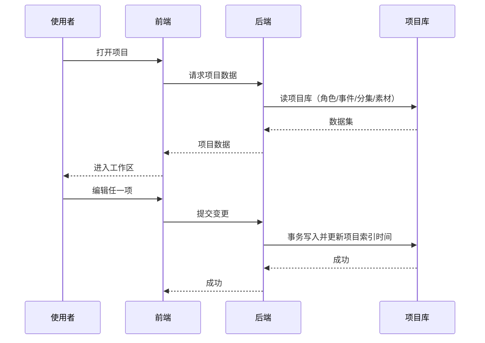
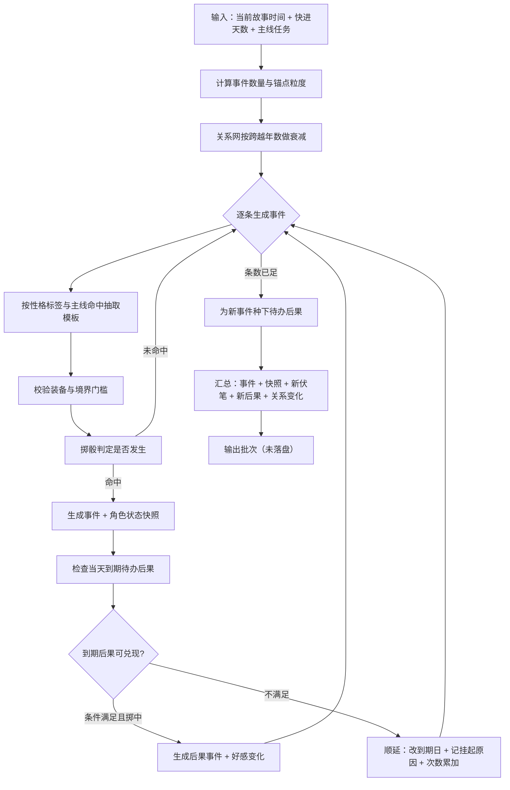
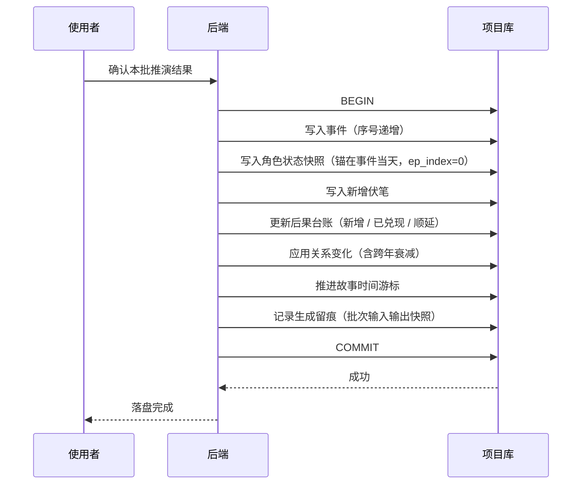
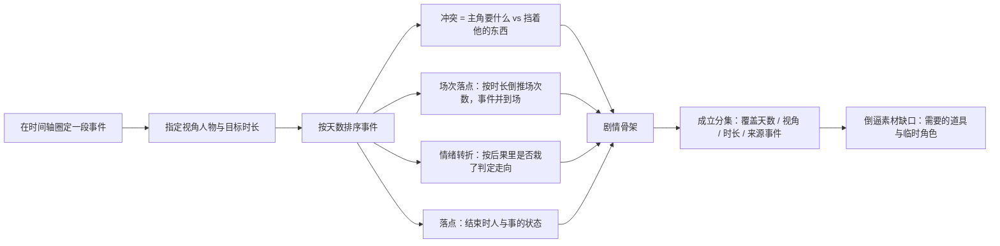
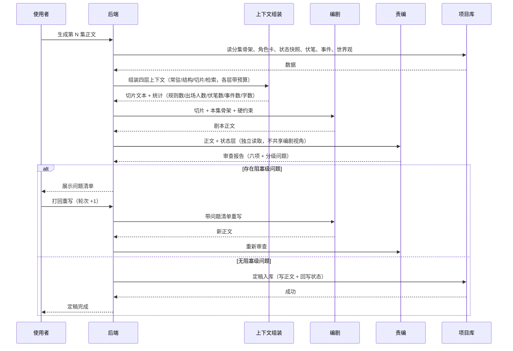
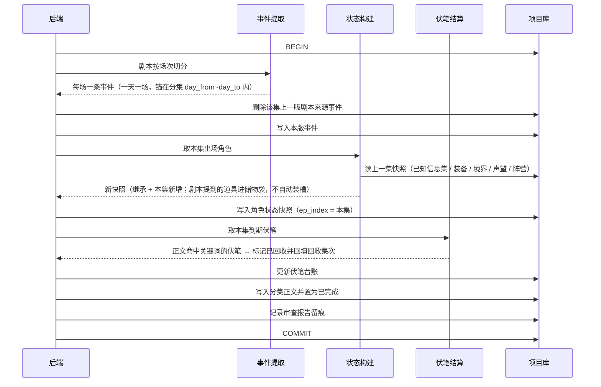
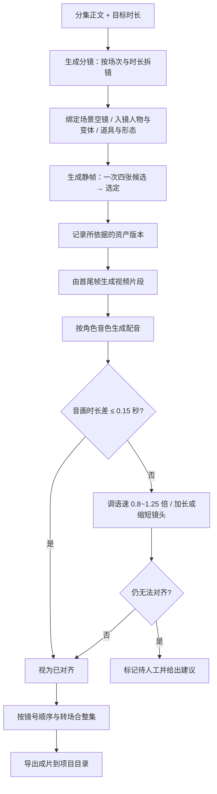

# AI漫剧工作台 数据流设计

## 0. 总览

```text
[推演引擎]  世界观/角色/主线/故事时间 ──▶ 事件批次（未落盘）──确认──▶ 事件流 + 状态快照 + 后果台账
                                                                        │
[编排]      事件流区间 ──▶ 剧情骨架 ──▶ 分集（覆盖天数 / 视角 / 时长 / 素材缺口）  │
                                                                        │
[双 Agent]  分集 + 上下文切片 ──▶ 编剧正文 ──▶ 责编审查 ──通过──▶ 分集正文        │
                                                                        │
[回写]      分集正文 ──▶ 事件（剧本来源）+ 角色状态快照 + 伏笔回收 ──────┘
                                                                        │
[制作]      分集 ──▶ 分镜 ──▶ 静帧 ──▶ 视频 ──▶ 配音 ──▶ 对齐 ──▶ 合成 ──▶ 成片
```

**贯穿全程的三条不变量**

1. **时间不变量**：推演阶段的事件锚在**天数**上；编排之后才产生集次，且分集带覆盖天数区间。任何阶段都不得用集次反推天数。
2. **确认不变量**：推演未确认不落盘；剧本未过审不定稿。半成品不得进入事件流与状态层。
3. **可重跑不变量**：推演、审查、回写都是纯逻辑；同一输入重跑产生同一结果。重生成某集时先清理该集上一版从剧本提取的事实。

---

## 1. 项目级数据流



- 系统库只负责项目索引；打开项目时切换到该项目的项目库。
- 编辑操作自动保存；写入以事务为单位，失败整体回滚。
- 项目索引的更新时间随写入刷新，用于项目列表排序。

---

## 2. 推演引擎数据流

### 2.1 快进推演（粗推）



**输入 / 输出**

| 项 | 内容 |
|---|---|
| 输入 | 项目标识、起始序号、起始故事时间、快进天数 |
| 输出 | 事件列表、角色状态快照、新增伏笔、新增待办后果、已兑现后果、顺延后果、关系变化、结束故事时间 |

**关键规则**

- 事件数量由快进天数决定（一周约两条，一个月约十条）；锚点粒度随这段的长度走。
- 抽取以性格标签驱动：高强度必触发、中 60%、低 30%；踩中主线的事件概率上抬并标记。
- 装备与境界不满足的事件模板不进入抽取池。
- 跨故事年时好感轴向 0 趋近（宿敌类除外）。
- 后果到期时先过两道闸（仇恨档位、掷骰），掷不中**顺延不销账**，台账记录顺延次数与挂起原因。

### 2.2 细化推演

```text
选中一条粗事件 → 指定子事件数量 → 子事件均匀落在母事件到下一个锚点之间
母事件保留不动（时间轴锚点 + 已细化凭据）→ 子事件标记 scale=fine 且 parent_id 指向母事件
```

只有细化到日的事件才允许进入编排。

### 2.3 确认落盘



- 未确认前可反复重跑，重跑只覆盖未确认批次，不产生脏数据。
- 落盘后故事时间游标不回退；需要重来时删除该批事件后重跑。

---

## 3. 三层转换：事件流 → 剧情编排 → 剧本

### 3.1 事件流 → 编排



**要点**

- 场次数量由目标时长倒推（约每三分钟一场），**与事件条数无关**：事件多于场次则并进同一场。
- 同一段事件换视角可编成多集，分集记录来源事件以便追溯。
- 未细化到日的事件不允许编排。
- 天数区间与已有分集重叠时提示（允许继续，但标记重叠）。

### 3.2 编排 → 剧本

见 §4 双 Agent 调用时序。

### 3.3 剧本 → 状态回写

见 §5。

---

## 4. 双 Agent 调用时序



**上下文切片四层**

| 层 | 内容 | 预算（字） |
|---|---|---|
| 常驻层 | 系列核心与世界观铁律 | 500 |
| 结构层 | 主线任务当前阶段与完成条件、本集骨架 | 300 |
| 切片层 | 出场角色卡、角色即时状态、活跃伏笔 | 1500 |
| 检索层 | 与本集关键词相关的历史事件摘要、上一集结尾 | 800 |

超出预算即截断（宁可少喂，不撑爆窗口），并提示本次字数与统计，不阻断生成。

**编剧硬约束**：不违反世界观铁律；不说角色不知道的信息；不突破当前力量上限；到期伏笔必收、要埋的埋得自然。

**责编六项审查**

| 检查项 | 判定 | 级别 |
|---|---|---|
| 世界观一致性 | 命中铁律关键词 → 提醒人工复核 | 提示 |
| 人物一致性 | 未登记角色开口 → 阻塞；单人台词占比 > 70% → 提示 | 阻塞 / 提示 |
| 信息集检查 | 角色说了不在其已知信息集的事实 → 阻塞 | 阻塞 |
| 伏笔执行 | 到期未收 → 阻塞；计划新埋未出现 → 提示 | 阻塞 / 提示 |
| 节奏合规 | 开场无钩子 / 结尾无悬念 → 提示 | 提示 |
| 故事时间 | 正文未体现本集既定故事时间 → 提示 | 提示 |

**判定规则**：仅当存在阻塞级（critical / high）问题时判为未通过；提示级允许带着走。审查轮次累加；连续三轮未通过则停止自动重写，提示人工介入。

---

## 5. 状态回写时序



**回写规则**

- 事件锚在分集覆盖天数区间内，一场一天，且不越过区间末日（粗推可能已推到第 360 天，而本集讲的是第 10~30 天的事）。
- 已知信息集继承上一集并叠加本集新获得的内容；剧本提到的道具进储物袋，是否装到装备槽由后续投放决定。
- 境界、声望、宗门、阵营剧本看不出变化，一律沿用上一集，留人工修改。
- 重新生成某一集时按集号清除上一版从剧本提取的事实，避免旧事实残留。

---

## 6. 制作链路数据流



**要点**

- 换基准图、重生成静帧或改动画面后，比对镜头锁定的资产版本与当前资产版本，不一致即标记该镜已过时并提示重新出图 / 出片。
- 无台词镜头不参与配音与音画对齐，合成时按静音处理。
- 外部服务不可用时，出图 / 出片 / 配音 / 合成各自阻断并提示，不影响其余环节与已生成资产。

---

## 7. 事务边界与失败处理

| 操作 | 事务范围 | 失败处理 |
|---|---|---|
| 推演落盘 | 事件 + 快照 + 伏笔 + 后果 + 关系 + 时间游标 + 留痕 | 整体回滚，保留未确认批次供重跑 |
| 定稿入库 | 清旧事件 + 写新事件 + 状态快照 + 伏笔 + 分集正文 + 报告 | 整体回滚，回到未定稿状态 |
| 分镜重排 | 镜头增删改 + 绑定关系 | 整体回滚 |
| 出图 / 出片 | 单镜资产写入（不跨镜） | 单镜失败不影响其它镜，记录失败原因 |
| 合成导出 | 单集 | 保留中间结果，提示具体失败原因 |

**一致性检查点**（建议在每次落盘前自动执行）

1. 事件天数是否落在所属分集区间内。
2. 待办后果的执行者与对象是否仍在故事中。
3. 角色状态快照是否按集唯一。
4. 分集覆盖天数是否越界或与其它集重叠。
5. 镜头引用的资产版本是否为当前基准版本。

---

## 8. 后端模块划分建议

| 模块 | 职责 | 是否依赖外部服务 |
|---|---|---|
| 故事时间 | 虚构历法、天数换算、锚点粒度 | 否（纯计算） |
| 推演引擎 | 粗推、细化、道具推演、性格演化、概率抽签 | 可选（模板生成可接模型） |
| 因果链 | 种因、到期判定、兑现、顺延 | 否 |
| 编排 | 骨架生成、分集成立、素材缺口 | 可选 |
| 上下文组装 | 四层切片与预算控制 | 否 |
| 编剧 / 责编 | 正文生成、六项审查 | 是（责编可降级为纯规则） |
| 状态回写 | 事件提取、状态构建、伏笔结算 | 否 |
| 素材与媒体 | 静帧、视频、配音、对齐 | 是 |
| 合成 | 整集拼接与导出 | 是（ffmpeg） |
| 留痕 | 生成批次与审查报告 | 否 |

纯计算模块应实现为可单测的纯函数服务；依赖外部服务的模块统一走"可用性检测 + 明确提示 + 允许重试"的外壳。

---

## 9. 待定项

| # | 事项 | 说明 |
|---|---|---|
| 1 | 推演是否逐步改为模型驱动 | 本期沿用模板 + 概率抽签，模型用于润色事件描述 |
| 2 | 编排是否允许一次编多集 | 本期一次一集 |
| 3 | 出图任务的排队与并发 | 受本地绘图服务性能限制，需定并发上限与排队策略 |
| 4 | 合成是否支持断点续合 | 本期按整集合成，失败保留中间结果 |
